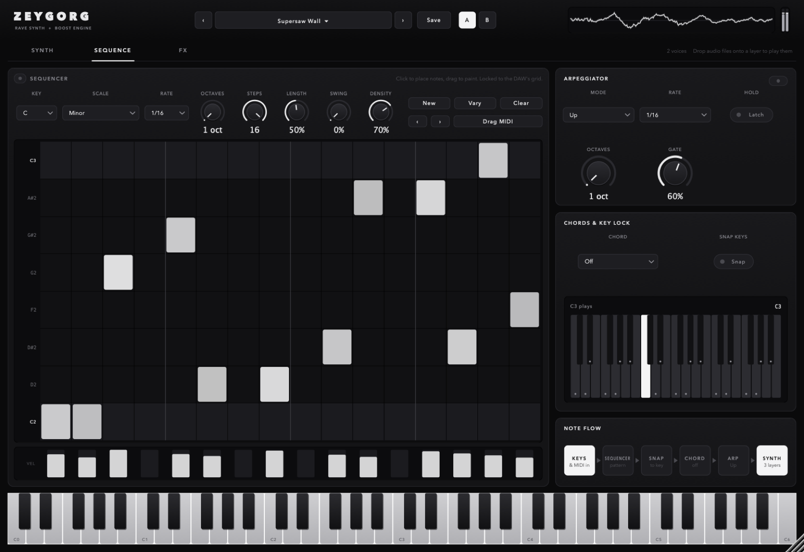
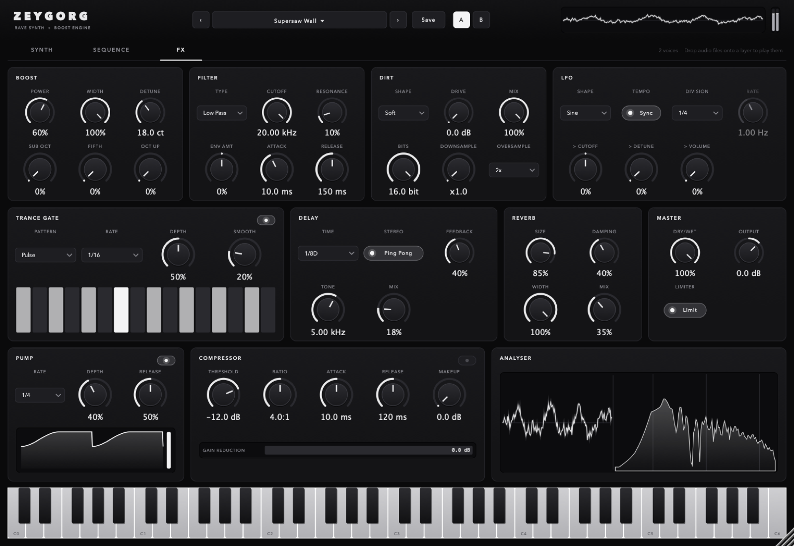

# Zeygorg

A rave synth and "boost" effect (VST3 / AU / Standalone, built with JUCE). A
three-layer synth (supersaws, oscillators, the built-in samples or your own
dragged-in audio, with warp and time-stretch) plays from its keyboard, host
MIDI, a step sequencer or an arpeggiator. Its output, plus any audio on the
track, then runs through a detuned boost stack, filter, distortion, LFO, trance
gate, delay, reverb, pump and compressor.


The window is resizable (drag the corner) and has three pages:

## Synth

| Section | Controls |
| --- | --- |
| **Layers 1-3** | Each layer has an on/off switch and a **Wave**: Supersaw, Saw, Square, Triangle, Sine, Noise or Sample. The rest of the layer's controls are **Level**, **Pan**, **Octave**, **Semi**, **Fine**, **Unison** (1-8 voices), **Detune** and **Spread**. The display shows the oscillator, or the sample's waveform with draggable start/end handles and the playhead (double-click the display to reset start/end). |
| **Samples** | Browse the 311 built-in samples with `‹` / `›` or the name menu, or **Load** / drag any WAV, AIFF, FLAC, MP3 or Ogg onto a layer. Dropped files are remembered by path in the project and presets; the root note is read from the file name (`Stab C#3`, `bass_F2`), otherwise C3. |
| **Warp** | **Repitch** plays the sample like a classic sampler. **Stretch** keeps the timing independent of pitch (**Speed** 0.25x-4x, granular, **Grain** size). **Tempo Sync** stretches the start-end region to a length in beats (**Length**) at the host tempo. Plus **Loop** and **Rev**erse. |
| **Amp Envelope** | Attack, Decay, Sustain, Release, Velocity, with a draggable envelope graph. |
| **Filter / Filter Envelope** | Per-voice low/band/high pass with **Cutoff**, **Resonance**, **Env Amt** (±6 octaves), **Key Track**, and its own ADSR. |
| **Voice** | **Poly**, **Mono** or **Legato**, **Glide**, **Transpose**, **Level**. |

## Sequence



| Section | Controls |
| --- | --- |
| **Sequencer** | A 16-step pattern in a **Key** and **Scale** (Major, Minor, Harmonic Minor, Dorian, Phrygian, Mixolydian, Minor/Major Pent, Blues, Chromatic). Click the grid to place notes, drag to paint, and drag the velocity bars. **Rate**, **Octaves**, **Steps** (loop length), **Length**, **Swing**. **New** rolls a random pattern (**Density** sets how full), **Vary** changes a few steps, `‹` / `›` shift it. **Drag MIDI** onto a MIDI track to drop the pattern into Live as a clip. It's locked to the DAW's bar while playing and runs free at the host tempo when stopped. |
| **Arpeggiator** | Up, Down, Up/Down, Random, As Played, Chord; **Rate**, **Octaves** (1-4), **Gate**, **Latch**. |
| **Chords & Key Lock** | **Chord** turns each note into Octave, Fifth, Major, Minor, Sus2, Sus4, Maj7, Min7, Min9, Rave Stab, or a triad / 7th built inside the key. **Snap Keys** forces played notes into the key. |
| **Note Flow** | Shows which stages are active: keys and MIDI, then sequencer, snap, chord, arp, and finally the synth. |

## FX



| Section | Controls |
| --- | --- |
| **Boost** | **Power** fades in up to 6 detuned copies (widest pair first), **Width**, **Detune** (0-50 cents), **Sub Oct**, **Fifth**, **Oct Up**. |
| **Filter** | Low / band / high pass, **Cutoff**, **Resonance**, with an envelope follower on the input (**Env Amt**, **Attack**, **Release**). |
| **Dirt** | **Drive** into Soft / Hard / Fold / Tube, **Bits**, **Downsample**, **Mix**, **Oversample** (off / 2x / 4x, cuts aliasing). |
| **LFO** | Sine / Triangle / Saw / Square / S&H, synced (**Division**) or free (**Rate**), to **Cutoff**, **Detune**, **Volume**. |
| **Trance Gate** | 16 steps, 6 patterns, **Rate**, **Depth**, **Smooth**. |
| **Delay** | Synced **Time**, **Ping Pong**, **Feedback**, **Tone**, **Mix**. |
| **Reverb** | **Size**, **Damping**, **Width**, **Mix**. |
| **Pump** | Tempo-synced sidechain-style ducking: **Rate** (1/8 to 1 bar), **Depth**, **Release**, with the curve drawn. |
| **Compressor** | **Threshold**, **Ratio**, **Attack**, **Release**, **Makeup**, with a gain-reduction meter. |
| **Master** | **Dry/Wet**, **Output**, and a peak **Limiter** (on by default, -0.3 dB). |
| **Analyser** | Output scope and spectrum. The header has a smaller one (click to switch) and a level meter. |

Signal flow:

```
keys + MIDI -> sequencer -> snap -> chord -> arp -> synth (3 layers) --+
                                                                       v
audio in ------------------------------------------------------------> + -> boost -> filter -> dirt
  -> LFO volume x gate -> delay -> reverb -> pump -> compressor -> dry/wet -> output -> limiter
```

## Presets

The header has the preset browser (`‹` / `›`, or click the name for the full
list), **Save**, and **A / B** to compare two versions of a sound (B starts as a
copy of A). There are 17 factory presets: stabs, hoovers, supersaw pads, acid
and arp sequences, dub chords, stretched strings and more. User presets are
saved to `~/Library/Application Support/Kebbell/Zeygorg/Presets` and can be
opened from the menu. Hosts also see the factory presets as programs.

## Samples

`Samples/` holds one-shot synth stabs from Vengeance *Essential Club Sounds
vol.2* (Synths, Acid, HiString), compiled into the plugin with
`juce_add_binary_data`, so the plugin is about 44 MB and needs no extra files.
Each sample's root note is read from its filename (`... 101 C#.wav`, with the
German `H` for B) and mapped to the octave of middle C.

These are commercial samples licensed to the repo owner for their own use.
Keep this repository private and don't distribute builds that contain them.

## Building

Needs CMake 3.22+ and a C++17 compiler (Xcode on macOS, Visual Studio 2022 on
Windows, GCC/Clang on Linux). JUCE 8 is downloaded automatically.

```bash
cmake -B build -DCMAKE_BUILD_TYPE=Release
cmake --build build --config Release
```

To use a JUCE checkout you already have instead of downloading it, add
`-DJUCE_DIR=/path/to/JUCE` to the first command.

Built plugins land in `build/Zeygorg_artefacts/Release/` (`VST3/`, `AU/`,
`Standalone/`). Copy them to your plugin folder:

- macOS: `/Library/Audio/Plug-Ins/VST3` and `/Library/Audio/Plug-Ins/Components`
- Windows: `C:\Program Files\Common Files\VST3`
- Linux: `~/.vst3`

On macOS every bundle is ad-hoc re-signed after it's built. Without that the
signature is invalid and Ableton's scanner rejects the plugin ("a sealed
resource is missing or invalid").

## Testing

`ZeygorgTest` renders the defaults, everything maxed and 20 random settings;
every oscillator wave, every warp mode, a dropped-in file and every factory
preset; and checks the sequencer (in key, repeats, pairs note on/off), chords,
arp, MIDI export, and that nothing clips at the defaults. It writes WAVs and
snapshots of each page (`ui-synth.png`, `ui-sequence.png`, `ui-fx.png`).

```bash
cmake --build build --target ZeygorgTest
./build/ZeygorgTest_artefacts/Release/ZeygorgTest out
```

`ZeygorgLoadTest` loads the built bundles the way a DAW does (scan, instantiate,
play a MIDI note, open the editor):

```bash
./build/ZeygorgLoadTest_artefacts/Release/ZeygorgLoadTest \
    "$PWD/build/Zeygorg_artefacts/Release/VST3/Zeygorg.vst3" \
    "$PWD/build/Zeygorg_artefacts/Release/AU/Zeygorg.component"
```

## Layout

```
Source/
  Parameters.h          parameter IDs, choice lists, APVTS layout
  PluginProcessor.*     MIDI pipeline, synth, engine, state, samples
  PluginEditor.*        window, header, tabs, keyboard, scaling
  Presets.h             factory/user presets and A/B (plugin-agnostic)
  FactoryPresets.h      Zeygorg's built-in sounds
  SampleLibrary.h       built-in samples and loading user files
  DSP/
    Synth.h             3-layer voices: oscillators, unison, sample warp/stretch, envelopes, filter, glide
    Sequencer.h         scales, the editable pattern, the tempo-synced sequencer
    NoteFx.h            chord/snap mapper and arpeggiator
    Engine.h            the effect chain
    RaveStack.h         pitch-shift voices for the boost stack
    Dirt.h              oversampled waveshaper, bitcrush, downsample
    Modulation.h        envelope follower, LFO, trance gate
    Delay.h             synced stereo / ping-pong delay
    Dynamics.h          pump, compressor, peak limiter
  UI/
    Theme.h             palette, fonts, look and feel (shared style)
    Widgets.*           knobs, menus, toggles, panels
    Displays.*          scope/spectrum, meters, envelope editor, pump curve
    LayerPanel.*        a synth layer with its waveform view and drop target
    SequencerPanel.*    step grid, velocity lane, MIDI drag, chord display
    PresetBar.*         preset browser and A/B
    Pages.*             the Synth, Sequence and FX pages
Samples/                the built-in WAVs
Tests/RenderTest.cpp    offline render and UI snapshot test
Tests/LoadTest.cpp      loads built plugins like a host
```

The theme, widgets, displays and preset manager don't depend on Zeygorg's
parameters, so they can move into a shared module for future plugins.

## Notes

- Changing from an older Zeygorg build: the old keys parameters (Keys Source,
  Sample, Transpose, Release, Level) became the layer and voice parameters, so
  projects saved with the first version reload with the synth at its defaults.
- The boost stack's pitch-shift voices add a little smear (30-60 ms grains),
  which is part of the chorus character; it isn't reported as latency.
