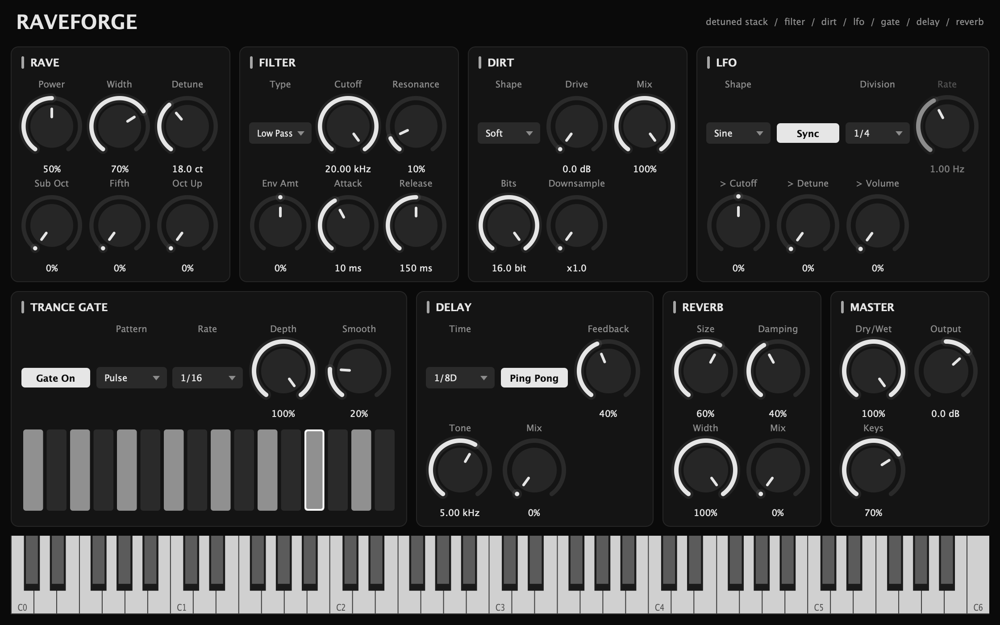

# Zeygorg

A JUCE audio effect (VST3 / AU / Standalone) in the spirit of Rave Generator:
it turns any input (or its own keys and built-in samples) into a big detuned
"boost" stack, then runs it through a
filter, distortion, LFO, trance gate, delay and reverb.



## Controls

| Section | Controls |
| --- | --- |
| **Boost** | **Power** fades in up to 6 detuned copies of the input (widest pair first). **Width** spreads them across the stereo field. **Detune** (0–50 cents). Pitched layers: **Sub Oct**, **Fifth**, **Oct Up**. |
| **Filter** | Low / band / high pass, **Cutoff**, **Resonance**. An envelope follower on the input moves the cutoff (**Env Amt**, **Attack**, **Release**). |
| **Dirt** | **Drive** into Soft / Hard / Fold / Tube shapes, **Bits** reduction, **Downsample**, **Mix**. |
| **LFO** | Sine / Triangle / Saw / Square / S&H. Tempo-synced (**Division**) or free (**Rate** in Hz). Routes to **Cutoff**, **Detune** and **Volume**. |
| **Trance Gate** | 16 steps, 6 patterns, **Rate** (1/8, 1/16, 1/32), **Depth**, **Smooth**. |
| **Delay** | Tempo-synced **Time**, **Feedback**, **Ping Pong**, **Tone** (darkens the repeats), **Mix**. |
| **Reverb** | **Size**, **Damping**, **Width**, **Mix**. |
| **Randomiser** | Plays random notes into the keys on the DAW's grid. **Key** and **Scale** (Major, Minor, Harmonic Minor, Dorian, Phrygian, Mixolydian, Minor/Major Pent, Blues, Chromatic), **Rate** (1/4 to 1/32, triplets), **Octaves**, **Chance** (how many steps play), **Length**. The pattern is a 16-step loop locked to the bar, so it repeats in time every pass; **New** rolls a different one (saved with the project). **Snap Keys** forces notes you play into the same key and scale. |
| **Master** | **Dry/Wet**, **Output**. |
| **Keys** | The keyboard (and host MIDI) plays either a saw or one of the 311 built-in samples into the start of the chain. **Source** (Saw / Samples), sample browser (`<` / `>` or click the name for a menu by category), **Transpose**, **Release**, **Level**. |

The randomiser, LFO, gate and delay follow the host tempo and bar position while the
transport is playing, and run free at the host tempo (or 128 BPM) when it is stopped.

Signal flow:

```
input → boost stack → filter (env + LFO) → dirt → LFO volume × gate → delay → reverb → dry/wet → output
```

## Samples

`Samples/` holds one-shot synth stabs from Vengeance *Essential Club Sounds
vol.2* (Synths, Acid, HiString), compiled into the plugin with
`juce_add_binary_data`, so the plugin is about 44 MB and needs no extra files.
Each sample's root note is read from its filename (`... 101 C#.wav`, with the
German `H` for B) and mapped to the octave of middle C; use **Transpose** if a
sample sits an octave off.

These are commercial samples licensed to the repo owner for their own use.
Keep this repository private and don't distribute builds that contain them.

To add more, drop WAVs (named with a root note) into a folder under `Samples/`
and re-run CMake.

## Building

Needs CMake 3.22+ and a C++17 compiler (Xcode on macOS, Visual Studio 2022 on
Windows, GCC/Clang on Linux). JUCE 8 is downloaded automatically.

```bash
cmake -B build -DCMAKE_BUILD_TYPE=Release
cmake --build build --config Release
```

To use a JUCE checkout you already have instead of downloading it, add
`-DJUCE_DIR=/path/to/JUCE` to the first command.

Built plugins land in `build/Zeygorg_artefacts/Release/` (`VST3/`, `AU/`,
`Standalone/`). Copy them to your plugin folder:

- macOS: `~/Library/Audio/Plug-Ins/VST3` and `~/Library/Audio/Plug-Ins/Components`
- Windows: `C:\Program Files\Common Files\VST3`
- Linux: `~/.vst3`

On Linux, install JUCE's dependencies first (`libasound2-dev libfreetype-dev
libx11-dev libxrandr-dev libxinerama-dev libxcursor-dev libgl-dev` and friends).

## Testing

`ZeygorgTest` renders a saw riff through the defaults, every parameter maxed,
a "showcase" patch and 20 random settings, and fails on any NaN/inf or runaway
level. It also writes `defaults.wav`, `showcase.wav` and a `ui.png` snapshot.

```bash
cmake --build build --target ZeygorgTest
./build/ZeygorgTest_artefacts/Release/ZeygorgTest out
```

`ZeygorgLoadTest` loads the built bundles the way a DAW does (scan, instantiate,
play a MIDI note, open the editor):

```bash
./build/ZeygorgLoadTest_artefacts/Release/ZeygorgLoadTest \
    "$PWD/build/Zeygorg_artefacts/Release/VST3/Zeygorg.vst3" \
    "$PWD/build/Zeygorg_artefacts/Release/AU/Zeygorg.component"
```

On macOS every bundle is ad-hoc re-signed after it's built. Without that the
signature is invalid and Ableton's scanner rejects the plugin ("a sealed
resource is missing or invalid").

## Layout

```
Source/
  Parameters.h        parameter IDs, choice lists, APVTS layout
  PluginProcessor.*   reads parameters + host tempo, runs the engine
  PluginEditor.*      UI (sections, knobs, gate step display)
  RaveLookAndFeel.h   colours and knob drawing
  DSP/
    Engine.h          the full effect chain
    RaveStack.h       pitch-shift voices for the detuned stack and layers
    Dirt.h            waveshaper, bitcrush, downsample
    Modulation.h      envelope follower, LFO, trance gate
    Delay.h           synced stereo / ping-pong delay
    KeysSynth.h       saw / sample voices for the keyboard
    Randomiser.h      scales and the tempo-synced random note generator
  SampleLibrary.h     lists and decodes the built-in samples
Samples/              the built-in WAVs
Tests/RenderTest.cpp  offline render smoke test
Tests/LoadTest.cpp    loads built plugins like a host
```

## Notes

- The distortion isn't oversampled, so heavy drive on bright material will alias.
- The pitch-shift voices add a little latency-like smear (the grain window is
  30–60 ms), which is part of the chorus character; it isn't reported to the host.
